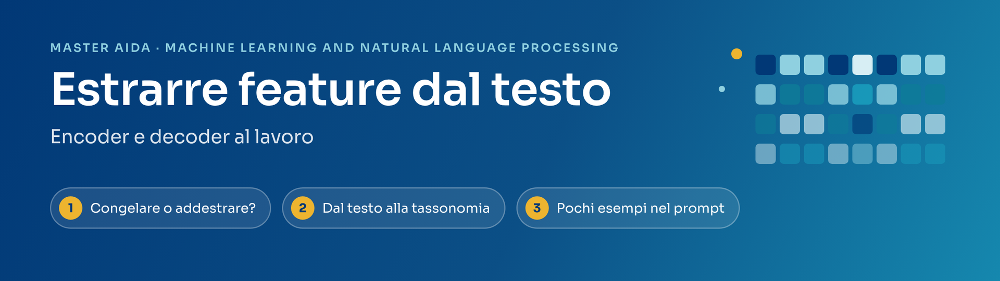
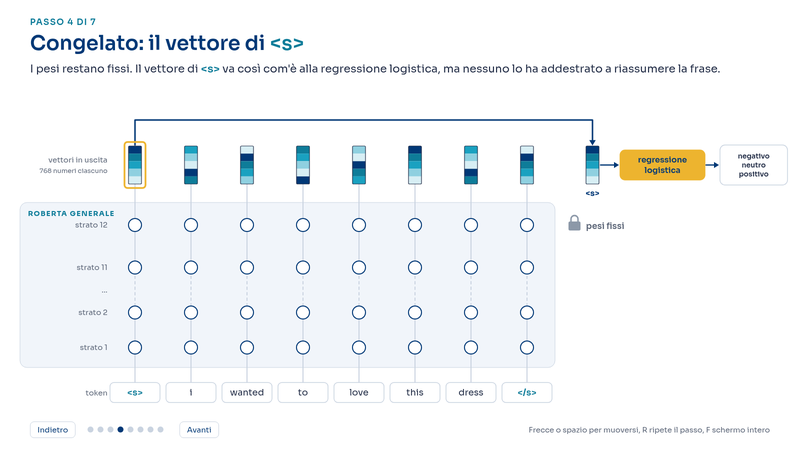
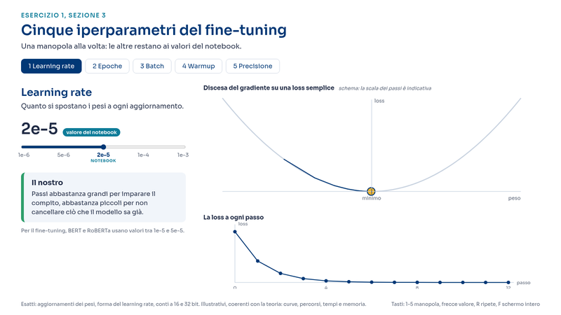
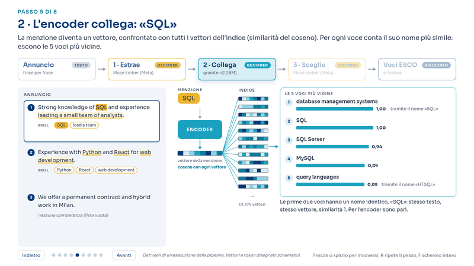
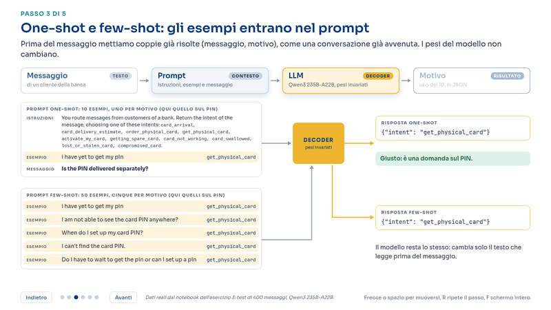

<p align="center">
  
</p>

<p align="center">
  <b>Machine Learning and Natural Language Processing</b><br>
  Master AIDA, Università di Milano-Bicocca, Edizione XVI, 2026<br>
  Esercitazione di Giuliano Lorenzo
</p>

In questa esercitazione trasformiamo il testo in **feature**: numeri e codici che un modello di machine learning può usare.
Lo facciamo con due famiglie di modelli: gli **encoder**, che riassumono un testo in un vettore, e i **decoder** (gli LLM),
che leggono, estraggono e scelgono. Gli esercizi sono tre, ognuno in un notebook pronto da aprire in Google Colab.

## Gli esercizi

| | Esercizio | Che cosa si impara | GPU |
|:--:|:--|:--|:--:|
| **1** | **Congelare o addestrare?**<br>Recensioni di abbigliamento: negative, neutre o positive<br><br>[](https://colab.research.google.com/github/giulianolorenzo-PhD/aida-ml-nlp/blob/main/esercizio_1.ipynb) | Usare un modello già addestrato come estrattore di feature oppure riaddestrarlo sui propri dati (fine-tuning). Salvare e ricaricare i modelli. | sì |
| **2** | **Dal testo alla tassonomia**<br>Annunci di lavoro e competenze<br><br>[](https://colab.research.google.com/github/giulianolorenzo-PhD/aida-ml-nlp/blob/main/esercizio_2.ipynb) | Un LLM estrae le competenze dagli annunci, un encoder le collega alla tassonomia europea ESCO. Confrontare strategie, modelli e costi. | sì |
| **3** | **Pochi esempi nel prompt**<br>Messaggi dei clienti di una banca<br><br>[](https://colab.research.google.com/github/giulianolorenzo-PhD/aida-ml-nlp/blob/main/esercizio_3.ipynb) | Zero-shot, one-shot e few-shot: insegnare un compito a un LLM con qualche esempio, senza addestrarlo. | no |

## Come iniziare

1. **Aprite il notebook** con il pulsante *Open in Colab*. Serve un account Google, nient'altro.
2. Colab avvisa che il notebook non è stato creato da Google: scegliete **Esegui comunque**.
3. **Esercizi 1 e 2**: il notebook chiede da solo una GPU T4. Se Colab non la assegna, aprite il menu
   *Runtime*, *Cambia tipo di runtime* e scegliete *T4 GPU*.
4. **Eseguite tutte le celle**: menu *Runtime*, *Esegui tutto*. Dati e modelli si scaricano da soli;
   le parti più lunghe hanno il tempo indicato nel testo.

Nei notebook trovate già i risultati dell'esecuzione usata per le slide: potete leggerli anche senza eseguire nulla.
Se rieseguite, alcuni numeri possono cambiare di poco, perché cambiano la GPU e, a volte, le risposte degli LLM.

## Le impostazioni

I notebook funzionano così come sono. Le impostazioni che potete cambiare sono nelle prime celle (sezione *Setup*)
e all'inizio delle sezioni indicate.

| Impostazione | Dove | Valore iniziale | Se la cambiate |
|:--|:--|:--|:--|
| `USE_DRIVE` | esercizi 1 e 2, Setup | `False`: i file prodotti (modelli, indici, risultati) restano nella sessione di Colab e spariscono quando si chiude. | `True`: vanno nel vostro Google Drive, nelle cartelle `aida_esercizio_1` e `aida_esercizio_2`, e restano. Occupano circa 1,2 GB e 0,5 GB. |
| `USE_COURSE_CACHE` | esercizi 2 e 3, Setup | `True`: si usano le risposte degli LLM già salvate in questo repository. Non servono chiave né credito. | `False`: ogni richiesta parte da zero con la vostra chiave. Costa meno di 20 centesimi di dollaro per l'esercizio 2 e circa 22 per il 3. |
| `MAIN` e `DECODERS` | esercizio 2, sezioni 4 e 5 | Il decoder principale è Muse Ember (Meta); Qwen3 30B-A3B serve per il confronto. | Potete provare altri modelli di OpenRouter. Serve la chiave. |
| `MODEL` | esercizio 3, sezione 2 | Qwen3 235B-A22B. | Potete provare altri modelli di OpenRouter. Serve la chiave. |

## La chiave OpenRouter, se volete andare oltre

Gli esercizi 2 e 3 usano gli LLM tramite [OpenRouter](https://openrouter.ai), un servizio che dà accesso a centinaia di
modelli con un'unica chiave. Le risposte usate a lezione sono già salvate, quindi **la chiave non serve**. Diventa necessaria
solo per richieste nuove: un altro modello, istruzioni diverse, i vostri testi.

1. Create un account su [openrouter.ai](https://openrouter.ai), aggiungete qualche euro di credito (*Credits*)
   e create una chiave (*Keys*).
2. In Colab aprite i **Secrets**, con l'icona della chiave nella barra a sinistra. Aggiungete un secret con nome
   `OPENROUTER_API_KEY`, incollate la chiave come valore e attivate l'accesso per il notebook.
3. Rieseguite il Setup: il notebook scrive `Chiave caricata: True`.

La chiave resta nel vostro account Google e non finisce nel notebook, nemmeno se lo condividete.
**Non scrivetela mai nel codice.** Le risposte già salvate restano gratuite anche quando la chiave c'è.

## Salvare il vostro lavoro

Le modifiche fatte su Colab non cambiano questo repository. Per conservarle usate *File*, *Salva una copia in Drive*:
da quel momento lavorate sulla vostra copia. Per conservare anche i file prodotti dai notebook impostate `USE_DRIVE = True`.

## Le visualizzazioni

Le animazioni usate a lezione si aprono nel browser: si va avanti con le frecce o la barra spaziatrice.
Per usarle senza internet scaricate il file HTML dalla cartella `visualizzazioni/` e apritelo: funziona anche offline.

<table>
  <tr>
    <td width="50%"><a href="https://giulianolorenzo-phd.github.io/aida-ml-nlp/visualizzazioni/01_perche_la_testa_usa_s.html"></a><br>
      <b>Esercizio 1.</b> Perché la testa di classificazione usa il token <code>&lt;s&gt;</code></td>
    <td width="50%"><a href="https://giulianolorenzo-phd.github.io/aida-ml-nlp/visualizzazioni/02_manopole_del_fine-tuning.html"></a><br>
      <b>Esercizio 1.</b> Gli iperparametri del fine-tuning, da provare uno alla volta</td>
  </tr>
  <tr>
    <td width="50%"><a href="https://giulianolorenzo-phd.github.io/aida-ml-nlp/visualizzazioni/03_un_annuncio_nella_pipeline.html"></a><br>
      <b>Esercizio 2.</b> Un annuncio attraverso la pipeline, dall'estrazione alle voci ESCO</td>
    <td width="50%"><a href="https://giulianolorenzo-phd.github.io/aida-ml-nlp/visualizzazioni/04_pochi_esempi_nel_prompt.html"></a><br>
      <b>Esercizio 3.</b> Zero-shot, one-shot e few-shot sullo stesso messaggio</td>
  </tr>
</table>

## Se qualcosa non va

- **Colab non assegna la GPU.** La GPU gratuita ha limiti d'uso: riprovate più tardi. L'esercizio 3 non ne ha bisogno.
  Quando avete finito chiudete il runtime (*Runtime*, *Disconnetti ed elimina runtime*), così non consumate la quota.
- **«Richieste non in cache, saltate» nell'esercizio 2.** Su una GPU diversa può cambiare di poco uno dei candidati
  proposti dall'encoder, e la richiesta corrispondente non è tra quelle salvate. Senza chiave viene saltata: il notebook
  arriva comunque in fondo, con risultati che possono differire di poco. Con la chiave la richiesta viene fatta.
- **«Questa richiesta non è nella cache» nell'esercizio 3.** Avete cambiato modello, istruzioni o esempi: serve la chiave.
- **`Chiave caricata: False` anche se avete salvato la chiave.** Nel pannello dei Secrets controllate il nome
  `OPENROUTER_API_KEY` e che l'accesso per il notebook sia attivo, poi rieseguite il Setup.

## Per il project work

Gli stessi schemi funzionano con i vostri dati:

- **esercizio 1**, quando avete testi con un'etichetta da prevedere e almeno qualche centinaio di esempi annotati;
- **esercizio 2**, quando dovete ricondurre testi liberi a un elenco di voci: categorie di ticket, codici ATECO,
  categorie di prodotto, competenze;
- **esercizio 3**, quando le categorie sono poche e gli esempi etichettati scarseggiano.

Partite da un campione piccolo, misurate su dati che il modello non ha visto e tenete d'occhio i costi.

## Che cosa c'è nel repository

```
esercizio_1.ipynb       Esercizio 1: congelare o addestrare?
esercizio_2.ipynb       Esercizio 2: dal testo alla tassonomia
esercizio_3.ipynb       Esercizio 3: pochi esempi nel prompt
materiale/              le risposte degli LLM già salvate (esercizi 2 e 3)
visualizzazioni/        le animazioni della lezione (pagine HTML)
immagini/               le immagini di questa pagina
```

## Dati

- Women's E-Commerce Clothing Reviews (Kaggle, nicapotato).
- ESCO v1.1.1, la classificazione europea di competenze e occupazioni (Commissione Europea).
- TechWolf skill-extraction (tech e house), Hugging Face, licenza CC BY 4.0 (Decorte et al., 2022).
- BANKING77 (PolyAI), Hugging Face, licenza CC BY 4.0 (Casanueva et al., 2020).
